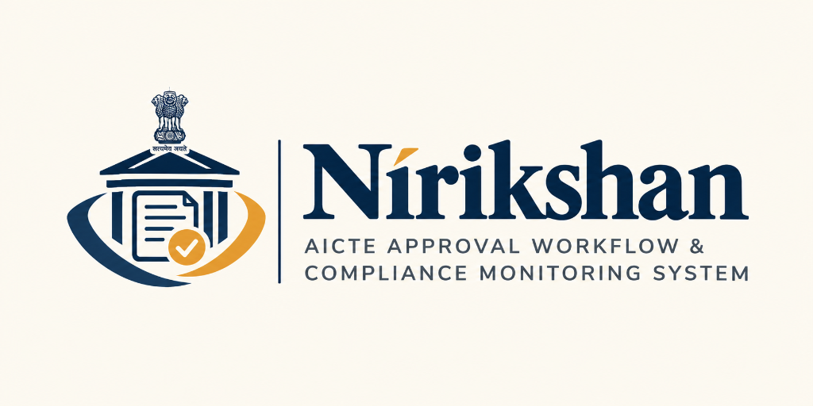
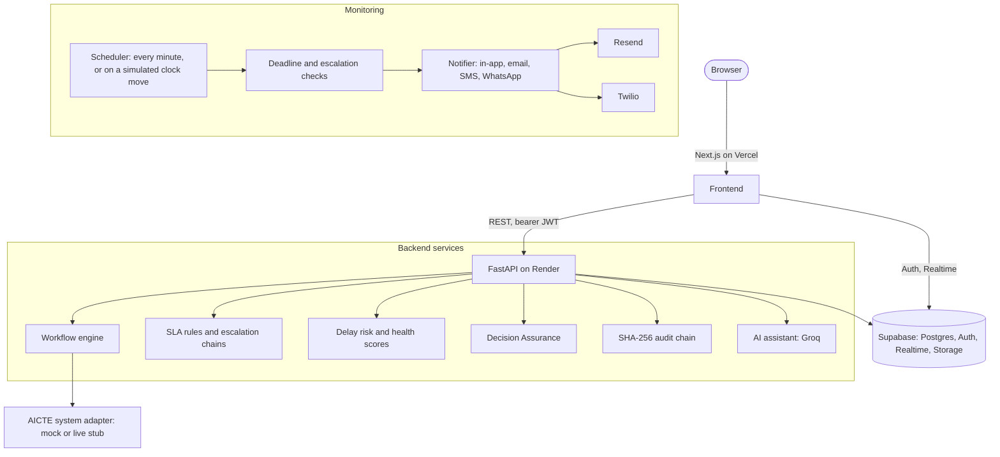

<div align="center">



### AICTE approval workflow, SLA monitoring and compliance governance

Smart India Hackathon · Problem statement **SIH26262**

[](https://nirikshan-six.vercel.app)
[](https://nirikshan-api-p3jg.onrender.com/docs)


</div>

> *Advisory only: final decisions rest with the competent authority. Designed to align with the Digital Personal Data Protection Act, 2023.*

Nirikshan takes an AICTE approval application from submission to final decision. It tracks every stage against its statutory deadline, warns the people responsible before a deadline is missed, escalates when it is, and records every action in a tamper-evident audit trail.

**Full solution document:** [SOLUTION.md](SOLUTION.md) covers the problem statement, every feature in detail, the tech stack and the architecture.

---

## Live deployment

| | Link |
| :--- | :--- |
| **Web app** | **https://nirikshan-six.vercel.app** (opens the welcome page with the 2-minute walkthrough) |
| **API** | https://nirikshan-api-p3jg.onrender.com · interactive docs at [`/docs`](https://nirikshan-api-p3jg.onrender.com/docs) · health at [`/health`](https://nirikshan-api-p3jg.onrender.com/health) |

> The API runs on Render's free plan, which sleeps after 15 idle minutes. The first request after that takes up to a minute; open the site a minute before a demo.

Every demo account uses the password `password123`, and the welcome and login pages sign you in with one click.

---

## Contents

- [Solution document](SOLUTION.md)
- [Features](#features)
- [Tech stack](#tech-stack)
- [Architecture](#architecture)
- [Try it in 2 minutes](#try-it-in-2-minutes)
- [Demo accounts](#demo-accounts)
- [Escalation matrix](#escalation-matrix)
- [Security and privacy](#security-and-privacy)
- [Project structure](#project-structure)
- [Local setup](#local-setup)
- [Deployment](#deployment)

---

## Features

**Workflow and deadlines**
- Configurable approval workflows (Scrutiny → EVC → SAC/SHC → final decision), with each stage owned by one role and assigned to the least-loaded officer.
- Applications are routed automatically: the workflow follows from what is applied for (eight types, from extension of approval to appeals) and the institution's record (health score, expired documents, NBA accreditation). The institution sees the route and the reasons before submitting, and cannot choose it.
- A live SLA countdown on every stage, a delay-risk score (0–100) per application and a compliance health score (0–100) per institution.
- A compliance calendar for institutions: undertakings, document expiries and upcoming deadlines in one place.

**Alerts and escalation**
- Reminders before a deadline, overdue alerts on it, and escalation through up to three levels after it.
- Delivery by in-app notification (live, through Supabase Realtime), email (Resend), SMS and WhatsApp (Twilio), tracked per recipient and channel, with fallback to the next channel on critical alerts.
- Alerts can be acknowledged from a signed email link without signing in.

**AI assistance (advisory only)**
- Case summaries, deficiency letter drafts and wording polish for officers.
- A case copilot on each application: ask "why is this case delayed?" and get an answer built only from the case record (stage history against time limits, returns, alerts, EVC, documents), with every number checked against it. It drafts an escalation message to the next level up, which the officer edits and sends in-app; sending is audited.
- Natural-language questions over the caseload.
- A daily brief on each dashboard: facts computed from live data, summarised by AI, with the summary dropped if it states a number the facts do not.
- Reads uploaded leases and certificates (OCR): the expiry date for a person to confirm, plus the institution name, land area, survey number and start date as printed.
- Runs on Groq with a failover key, and falls back to a mock mode when no key is set.

**Decision Assurance**
- Checks a final decision before it is committed: missing or expired documents, unusual patterns, and documents that disagree with each other. Land areas are compared across units (acres, hectares, sq m, sq ft, gunthas), and survey numbers and institution names across the ways they are written. Each flag must be acknowledged or overridden with a reason.
- Re-checks committed decisions when a supporting document later expires.

**Governance**
- A SHA-256 hash-chained audit trail, verifiable end to end from the audit page.
- Maker-checker: rule and timeline changes apply only after a second administrator approves.
- Reports in JSON, PDF and Excel: pendency, overdue summary and audit.
- A time simulator for the demo: move the clock forward and watch deadlines, alerts and escalations play out.
- English and Hindi interface.

---

## Tech stack

| Layer | Technologies |
| :--- | :--- |
| **Frontend** | Next.js 16 (App Router, Cache Components), React 19, TypeScript, Tailwind CSS 4, lucide-react |
| **Backend** | FastAPI, Uvicorn, Pydantic 2, APScheduler, httpx, `limits` (rate limiting) |
| **Database and auth** | Supabase: PostgreSQL with row-level security, Auth with TOTP MFA, Realtime, private Storage |
| **AI** | Groq: `openai/gpt-oss-120b` for text, `qwen/qwen3.8-27b` for images; pypdf and Pillow for document input |
| **Messaging** | Resend (email), Twilio (SMS, WhatsApp); simulated when not configured |
| **Reports** | ReportLab (PDF), openpyxl (Excel) |
| **Hosting** | Vercel (frontend), Render (API), Supabase (data) |
| **Quality** | pytest suite against a live Supabase project; GitHub Actions CI with `pip-audit`, `npm audit` and a production build |

---

## Architecture



---

## Try it in 2 minutes

The same steps are on the [welcome page](https://nirikshan-six.vercel.app/welcome), where each one signs you in as the right person and opens the right screen.

| # | Sign in as | Do this | Look for |
| :-: | :--- | :--- | :--- |
| 1 | Institution | Open **New application**, choose **Extension of approval**, answer **Yes** to the changes question, accept the declaration and submit. | The route (Scrutiny and EVC) is decided for you, with its reasons. It starts in Scrutiny with a due date 15 days away. |
| 2 | Scrutiny officer | Open the newest application, read the AI case summary, press **Advance to EVC Queue**. | The stage tracker moves to the EVC queue, owned by the regional officer. |
| 3 | Admin | In the **Time Simulator**, press **+7 days**. | Case B goes from due in 2 days to 5 days overdue, and its escalations fire. |
| 4 | Regional officer | Open **Alerts**, find `DEMO-CASE-B` at level 2, press **Delivery**. | In-app, email and SMS delivery for each recipient. |
| 5 | Institution | Download the [sample lease](https://nirikshan-six.vercel.app/samples/sample_lease.png) and upload it as a lease renewal. | The expiry date (31 March 2028) is read from the document; accept it to save. |
| 6 | Bureau officer | Open the **Audit** trail and press **Verify integrity**. | Every entry checks out, and your actions from steps 1–5 are listed. |

The admin can press **Reset** in the simulator to return to the real date.

---

## Demo accounts

Password for every account: `password123`.

| Role | Email | What they do |
| :--- | :--- | :--- |
| **Institution** | `institution@demo.sih` | Submits applications, tracks deadlines and health score, uploads documents and undertakings |
| **Scrutiny officer** | `scrutiny@demo.sih` | Examines submissions, records deficiencies, advances cases |
| **Regional officer** | `regional@demo.sih` | Watches pendency in the Western region, manages the EVC queue, receives level 2 escalations |
| **Regional officer (MFA)** | `mfa.officer@demo.sih` | The same, but signs in with an authenticator app (TOTP) |
| **EVC members** | `evc@demo.sih`, `evc2@demo.sih`, `evc3@demo.sih` | Visit schedules, inspections and reports; availability drives suggested visit dates |
| **SAC/SHC member** | `sacshc@demo.sih` | Sees only the cases assigned to them |
| **Bureau officer** | `bureau@demo.sih` | National overview, level 3 escalations, final decisions with Decision Assurance, approves overrides |
| **Administrator** | `admin@demo.sih` | Proposes SLA and rule changes, runs the time simulator, manages users; no access to case data |
| **Second administrator** | `admin2@demo.sih` | Approves the first administrator's rule changes (maker-checker) |
| **Auditor** | `auditor@demo.sih` | Read-only audit trail, document access logs and reports |

**Seeded cases:**
- **B:** in Scrutiny and due in 2 days, used by the walkthrough.
- **G:** a final decision with four kinds of assurance flag, including a lease and a land-use certificate that disagree on land area and survey number.
- **H:** a committed decision whose lease expires in 10 days, so a +15 day jump raises a post-decision flag.
- **I:** upload the sample lease and accept the suggested expiry date.

---

## Escalation matrix

| Level | When | Who | Channels |
| :--- | :--- | :--- | :--- |
| **Level 1** | On the due date | Assigned officer | In-app, email |
| **Level 2** | 3 days overdue | Regional officer | In-app, email, SMS |
| **Level 3** | 7 days overdue | Bureau officers | In-app, email, SMS, WhatsApp |

Administrators edit timelines and chains, and a second administrator approves each change. Unacknowledged alerts escalate again. Email, SMS and WhatsApp messages carry only the reference number, the alert type and a signed link.

---

## Security and privacy

**In the prototype**
- **Tamper-evident audit chain:** every transition, document action and rule change is a SHA-256 linked entry, verifiable from `/audit`.
- **Role separation:** the administrator manages rules and users but has no route to case data; the auditor is read-only.
- **MFA:** officer routes require a TOTP-verified session. `DEMO_MFA_BYPASS` lets demo officers skip it, and must be off in a real deployment.
- **Rate limits and lockout:** login, OTP and AI endpoints are rate limited, and repeated failed logins lock the account.
- **Maker-checker:** rule and timeline changes need a second administrator; case reverts and assurance overrides can require a bureau officer's approval.
- **Document protection:**
  - Uploads are limited to PDF, PNG or JPG up to 10 MB, checked by content.
  - Each file is hashed with SHA-256 and kept in a private bucket.
  - Files are served only through links that expire after 5 minutes.
  - Every access is logged, and bulk downloads alert the bureau.
- **Advisory-only AI:** it summarises, drafts and suggests. A person confirms every date and sends every message, and the AI never approves, rejects or advances a case.
- **Privacy:** contact details are masked in lists and revealed (and audited) on detail views; exports are limited and logged.

**Production design only (not built):**
- SSO with AICTE systems, and maker-checker on every sensitive action.
- Malware scanning; a hook is marked in `services/storage.py`.
- Alerts on unusual login locations.
- Backups with tested restore, and disaster recovery.
- Central logging and monitoring, and VAPT.
- Government-approved hosting, and retention rules agreed with AICTE.

---

## Project structure

```
aicte-workflow/
├── frontend/                 Next.js app (deployed to Vercel)
│   ├── app/                  Pages: dashboards, applications, alerts, documents, EVC, audit, admin
│   ├── components/           Navbar, alert bell, assurance and AI panels, uploads
│   ├── context/              Language (English / Hindi)
│   └── lib/                  API client, Supabase client, demo walkthrough steps
├── backend/                  FastAPI service (deployed to Render)
│   ├── routers/              REST endpoints under /api/v1
│   ├── services/             Workflow engine, scheduler, notifier, LLM, assurance, audit, reports
│   ├── core/                 Settings, auth, simulated clock, rate limiting
│   ├── adapters/             AICTE system adapter (mock and live stub)
│   ├── seed/                 Demo data and scripted cases
│   └── tests/                pytest suite
├── supabase/migrations/      Schema, row-level security, views, realtime
├── render.yaml               Render blueprint for the API
├── SOLUTION.md               Problem, features, tech stack and architecture in detail
└── docs/SPEC.md              Specification
```

---

## Local setup

**Prerequisites:** Node.js 20.9+ (required by Next.js 16), Python 3.12, and a Supabase project with the migrations in `supabase/migrations` applied.

### Backend

```bash
cd backend
python3 -m venv .venv
source .venv/bin/activate
pip install -r requirements.txt
cp .env.example .env          # then fill in Supabase, Groq and Resend values

python -m seed.seed           # seed data (first run)
python seed/demo_cases.py     # reset the scripted demo cases (Case B due in 2 days)

uvicorn main:app --reload --port 8000
```

API docs at `http://localhost:8000/docs`, health at `http://localhost:8000/health`.

### Frontend

```bash
cd frontend
npm install
cp .env.example .env.local    # Supabase URL, anon key, NEXT_PUBLIC_API_URL
npm run dev
```

Open `http://localhost:3000`, which redirects to `/welcome`.

### Tests

```bash
cd backend
pytest tests/
```

The tests cover:
- workflow transitions and application routing, and scheduler alerting and escalation;
- the audit chain, and risk and health scores;
- Decision Assurance on cases G and H, and the anomaly flag;
- OCR, and EVC date suggestions;
- channel delivery and webhooks, the daily brief, and the security checks.

They run against the Supabase project in `backend/.env` and write test rows to it, so point them at a test project. Set `RESEND_API_KEY=` when running them, so emails are simulated rather than sent.

### Optional delivery providers

- **Email:** set `RESEND_API_KEY`, plus `RESEND_WEBHOOK_SECRET` for delivery-status callbacks.
- **SMS and WhatsApp:** set `TWILIO_ACCOUNT_SID`, `TWILIO_AUTH_TOKEN`, `TWILIO_SMS_FROM` and `TWILIO_WHATSAPP_FROM`.
- **Webhooks:** point the providers at `<API_PUBLIC_URL>/api/v1/webhooks/resend` and `/webhooks/twilio`.
- **Demo inbox:** `DEMO_EMAIL_REDIRECT` sends every email to one inbox, with the intended recipient shown in the subject.

Without these, deliveries are simulated and marked as such.

---

## Deployment

### API on Render
1. In Render, choose **New → Blueprint** and pick this repo. `render.yaml` defines the `nirikshan-api` web service: root `backend`, Python 3.12, and a `/health` check.
2. Add the secrets under **Environment**:
   - `SUPABASE_URL`, `SUPABASE_SERVICE_KEY` and `SUPABASE_JWT_SECRET`; the JWT secret also signs alert and document links.
   - `GROQ_API_KEY` and `GROQ_API_KEY_FAILSAFE`.
   - `RESEND_API_KEY` and `DEMO_EMAIL_REDIRECT`.
   - `API_PUBLIC_URL`: the Render URL.
3. Set `FRONTEND_ORIGIN` to the Vercel URL; it's used for CORS and for links in emails.
4. Optional:
   - `CORS_ORIGIN_REGEX`, to allow Vercel preview deployments.
   - `SCHEDULER_ENABLED=true`, for checks every minute. Run a single instance, since rate limits and the scheduler are per process.

`backend/railway.json` holds equivalent settings for Railway.

### Frontend on Vercel
1. Import the repo with **Root Directory** `frontend` (framework preset Next.js).
2. Set `NEXT_PUBLIC_SUPABASE_URL`, `NEXT_PUBLIC_SUPABASE_ANON_KEY` and `NEXT_PUBLIC_API_URL` (`<Render URL>/api/v1`). These are built into the bundle, so redeploy after changing them.
