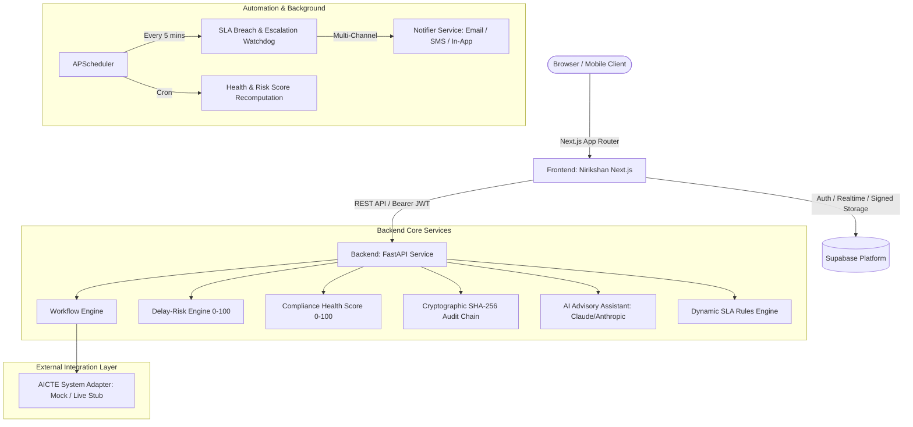

# Nirikshan (SIH26262)

> **AICTE Workflow Automation, SLA Monitoring & Statutory Governance Platform**
> 
> *Advisory only — final decisions rest with the competent authority. Designed to align with the Digital Personal Data Protection Act, 2023.*

Nirikshan provides end-to-end statutory workflow automation, real-time SLA countdowns, multi-channel escalation before pendency breaches occur, and a tamper-evident cryptographic audit log for all AICTE approval stages.

---

## 1. System Architecture



---

## 2. Evaluation Demo Credentials

All evaluation accounts use the standard password: `password123`. Click any persona on the **[Welcome Page](http://localhost:3000/welcome)** to sign in automatically:

| Role | Demo Email | Scope & Purpose |
| :--- | :--- | :--- |
| **Institution** | `institution@demo.sih` | Submit applications, track live health score, resolve deficient undertakings |
| **Scrutiny Officer** | `scrutiny@demo.sih` | Examine submissions, verify documentation, record deficiencies |
| **Regional Officer** | `regional@demo.sih` | Monitor pendency in Western region, rebalance officer workloads, queue EVCs |
| **EVC Member** | `evc@demo.sih` | Review on-site visit schedule, conduct inspection, upload EVC reports |
| **Bureau Officer** | `bureau@demo.sih` | National overview, intervene on Level-3 escalations, verify audit trail |
| **Administrator** | `admin@demo.sih` | Configure stage SLAs, run Time-Travel simulator, rule maker-checker |

---

## 3. "Try It in 2 Minutes" Judge Walkthrough

To verify the complete system end-to-end using pre-seeded test cases:

1. **Submit Application as Institution**:
   - Log in as `institution@demo.sih`, open **Applications**, and submit an approval request.
   - Observe the initial statutory stage countdown (SLA timer).
2. **Advance Application as Regional Officer**:
   - Switch to `regional@demo.sih`, open the case, verify and advance past Scrutiny.
   - Watch the interactive stage tracker advance immediately to **EVC Queue**.
3. **Simulate +7 Days Time-Travel**:
   - Switch to `admin@demo.sih`, open **Time Simulator** at `/admin/simulator`, and advance time by **+7 days**.
4. **Inspect Automated Overdue Alerts & Escalations**:
   - Switch back to `regional@demo.sih` and check **Alerts**. Case B turns Critical and displays an automated **Level 2 Escalation** (dispatched to Regional Officer via Email, SMS, and in-app).
5. **Renew Expiring Document**:
   - Switch to `institution@demo.sih`, open **Documents** to review the lease expiring in 28 days, and upload a renewed PDF lease agreement.
6. **Verify Cryptographic Audit Integrity**:
   - Switch to `bureau@demo.sih`, navigate to `/audit`, and click **Verify Integrity**.
   - The engine validates the unbroken SHA-256 hash sequence from the genesis block to the latest mutation.

---

## 4. Multi-Channel Escalation Matrix

When statutory deadlines approach or expire, notifications escalate according to configurable policies:

| Escalation Level | Trigger Window | Recipients | Delivery Channels |
| :--- | :--- | :--- | :--- |
| **Level 1** | 0 days overdue (Day 0) | Assigned Scrutiny / EVC Officer | In-app notification, Email |
| **Level 2** | 3 days overdue (Day 3) | Regional Officer & Section Head | Email, SMS, In-app notice |
| **Level 3** | 7 days overdue (Day 7) | AICTE HQ Bureau Officers & Leadership | Priority Email, SMS, HQ Dashboard |

---

## 5. Security & Privacy Architecture

- **Tamper-Evident Audit Chain**: Every state transition, document submission, and rule edit generates an immutable SHA-256 block containing `prev_hash`, `payload`, `actor_id`, and a monotonic sequence ID.
- **Strict Role Separation**: Administrators can configure SLA rules and simulation offsets, but **cannot view case documentation or alter case decisions**.
- **Advisory-Only AI**: Large language models only summarize documentation and draft deficiency notices. **AI never approves, rejects, or advances cases autonomously**.
- **Data Minimization & DPDP Alignment**: Contact numbers and personal identifiers are masked in summary views and unmasked only upon authorized individual case inspection.
- **Production Design Roadmap**:
  - Government SSO (e-Pramaan / Jan Parichay)
  - Automated ClamAV malware scanning on document ingestion
  - Time-locked two-admin Maker-Checker approvals for statutory rule updates

---

## 6. Local Setup & Execution

### Prerequisites
- Node.js 18+ & npm
- Python 3.11+
- Running Supabase project (or local Supabase CLI)

### Backend Execution
```bash
cd backend
python3 -m venv .venv
source .venv/bin/activate
pip install -r requirements.txt

# Run database seed (if starting fresh)
python -m seed.seed

# Start FastAPI backend server
uvicorn main:app --reload --port 8000
```
Health endpoint: `http://localhost:8000/health`

### Frontend Execution
```bash
cd frontend
npm install
npm run dev
```
Portal interface: `http://localhost:3000` (Redirects to `/welcome`)

### Running Backend Regression Tests
```bash
cd backend
pytest tests/
```
All 47 tests cover workflow engine state transitions, scheduler idempotent alerting, multi-tier escalation, cryptographic audit verification, and differentiators (Risk & Health scoring).
