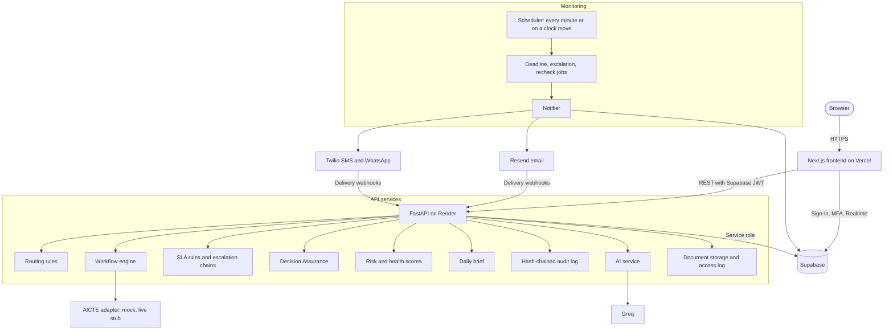
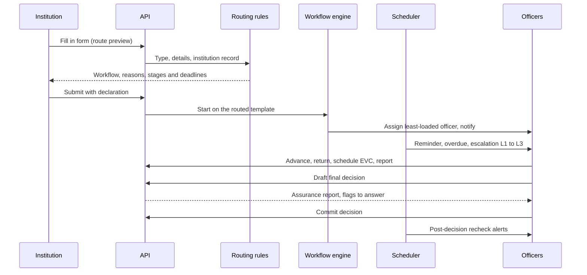

# Nirikshan: Solution Document

Smart India Hackathon · Problem statement **SIH26262** · AICTE approval workflow, SLA monitoring and compliance governance

Live app: https://nirikshan-six.vercel.app · API: https://nirikshan-api-p3jg.onrender.com/docs

> Advisory only: final decisions rest with the competent authority. Designed to align with the Digital Personal Data Protection Act, 2023.

---

## Contents

1. [The problem](#1-the-problem)
2. [How Nirikshan answers it](#2-how-nirikshan-answers-it)
3. [Users and roles](#3-users-and-roles)
4. [Features in detail](#4-features-in-detail)
5. [Tech stack](#5-tech-stack)
6. [Architecture](#6-architecture)
7. [Testing](#7-testing)
8. [Prototype limits and production path](#8-prototype-limits-and-production-path)

---

## 1. The problem

The problem statement areas below are taken from the build spec (`SIH26262 – Build Spec for the Coding Tool.md`). The spec was written to cover SIH26262 end to end.

AICTE approves technical institutions every year: extensions of approval, intake increases, new courses, new institutions and more. Each application passes through several hands: scrutiny of documents, an expert visit committee (EVC), sometimes the Standing Appellate/Hearing Committee (SAC/SHC), and a final decision by the bureau. After approval, institutions remain under obligations: undertakings to fulfil by a date, and statutory documents such as leases and fire NOCs that expire.

Today that process suffers from:

- **No single view of where a case is.** Stages are owned by different offices, and nobody sees the whole pipeline or which stage is holding things up.
- **Deadlines that slip silently.** Stage timelines, EVC scheduling, undertakings and document expiries are tracked by hand, so delays are noticed only after they happen.
- **Escalation that depends on people remembering.** There is no automatic reminder before a deadline, no alert on it, and no step-up to a senior officer after it.
- **Decisions that are hard to defend later.** It is difficult to show which documents a decision relied on, whether they were valid at the time, and who did what and when.
- **Rules fixed in process, not in configuration.** Timelines and escalation paths cannot be changed without changing the system, and changes are not controlled.

What the spec asks the solution to do:

| Area | Requirement |
| :--- | :--- |
| **A. Workflow** | Run approval applications through configurable stage workflows, with role ownership, return for deficiency, revert and reassignment. |
| **B. Timelines and monitoring** | Track every stage, EVC visit, undertaking and document against a deadline set by configurable rules. |
| **C. Alerts and escalation** | Remind before deadlines, alert on them, and escalate through levels after them, across channels, without duplicates. |
| **D. Dashboards and reports** | Role-specific dashboards, pendency and overdue analysis, and exportable reports. |
| **E. Governance** | A tamper-evident audit trail, controlled rule changes, role separation and privacy safeguards. |
| **F. Intelligence** | Advisory AI and scoring that help officers prioritise, never decide. |

---

## 2. How Nirikshan answers it

| Area | What Nirikshan does |
| :--- | :--- |
| **A. Workflow** | A workflow engine runs four stage templates. Each new application is routed to a template by rule, from what is applied for and the institution's record. Each stage is owned by one role and assigned to the least-loaded officer in the region. Returns, reverts and reassignments require a reason. |
| **B. Monitoring** | A scheduler checks five kinds of deadline every minute, or whenever the simulated clock moves. Deadlines come from SLA rules that administrators edit: region-specific first, then template-wide, then the template default. |
| **C. Escalation** | Reminders, overdue alerts and three escalation levels are delivered in-app (live), by email, SMS and WhatsApp. Delivery is tracked per recipient and channel. Alerts are idempotent, resolve themselves when the cause clears, and escalate again if nobody acknowledges them. |
| **D. Dashboards** | There is a dashboard for each role and an AI-written daily brief. Bureau and regional dashboards show region and stage pendency and officer workload, with a rebalancing suggestion. Reports export as JSON, PDF or Excel. |
| **E. Governance** | A SHA-256 hash-chained audit log can be verified from the UI. A second administrator approves every rule change. Decision Assurance checks the evidence behind every final decision. Row-level security, MFA, masked contact details and logged document access complete the safeguards. |
| **F. Intelligence** | Delay-risk and health scores, case summaries, deficiency letter drafts, natural-language search, OCR of leases and certificates, and a daily brief. All of it is labelled advisory and none of it changes a case. |

---

## 3. Users and roles

| Role | Sees | Does |
| :--- | :--- | :--- |
| **Institution** | Its own applications, documents, undertakings and calendar | Submits applications, responds to deficiencies, uploads documents and renewals, submits undertaking evidence |
| **Scrutiny officer** | Cases in their region | Examines submissions, returns for deficiency, advances cases |
| **Regional officer** | Cases in their region | Schedules EVC visits, reverts and reassigns, receives level 2 escalations, rebalances workload |
| **EVC member** | Visits in their region | Sets availability, records visit reports, completes visits |
| **SAC/SHC member** | Only the cases assigned to them | Reviews appeals and SAC/SHC-stage cases |
| **Bureau officer** | All regions | Takes final decisions with Decision Assurance, receives level 3 escalations, approves overrides when maker-checker is on |
| **Administrator** | Rules, users and settings; **no case data** | Proposes rule changes, manages users, imports data, runs the time simulator |
| **Auditor** | Audit trail, document access logs, reports | Read only |

Role and scope are enforced twice: by row-level security in Postgres and again in every FastAPI route.

---

## 4. Features in detail

### 4.1 Application submission and automatic routing

The institution fills in a structured application and never picks how it is processed.

**The form** (`/applications/new`)
- **Applicant card:** institution name, AICTE ID, location and regional office, filled in from the institution's record.
- **Academic year:** the next two years, for example 2027-28.
- **Application type:** one of eight: extension of approval, increase in intake, new course, change of name, change of site, new institution, restoration of intake, or appeal against a decision.
- **Details for the chosen type:**
  - level, discipline, course, approved and proposed intake, and NBA accreditation for an intake increase;
  - address, land area, and whether the land is owned or leased for a change of site;
  - the trust or society, address and land area for a new institution;
  - the decision appealed and the grounds for an appeal.
- **Declaration:** has to be accepted before submitting.

**How it will be processed.** A side panel, refreshed as the form changes, shows:
- the workflow the rules chose;
- the reason for each choice;
- every stage with its owner and its deadline, including any regional SLA rule;
- the expected total time.

**Routing rules** (`services/routing.py`)

| Application | Route |
| :--- | :--- |
| Extension of approval | Scrutiny only, unless the land, buildings or programmes changed, the health score is below 60, or a document on record has expired. Each of these adds an expert visit, with its own reason. |
| Increase in intake | Scrutiny only if the course is NBA accredited and the record is in order; otherwise an expert visit is added. |
| New course | Scrutiny only if the institution already runs the discipline with its labs; otherwise an expert visit is added. |
| Change of name | Scrutiny only |
| Change of site, new institution | Scrutiny, then an expert visit |
| Restoration of intake | Expert visit only (the documents are already on record) |
| Appeal | Expert visit, then the SAC/SHC hearing |

**On submission:**
- the server validates the fields for the type and ignores any workflow named in the request;
- the routing reason is recorded on the first stage and in the audit trail;
- the submitted form is saved as the first document in the case file, with a SHA-256 hash;
- the application page shows an **Application** card with the details and why the case was routed that way.

### 4.2 Workflow engine

`services/workflow_engine.py` runs every application through a template stored as JSON in `workflow_templates`.

| Template | Stages |
| :--- | :--- |
| `ONLY_SCRUTINY` | Scrutiny → Final decision (return loop through Institution response and Re-scrutiny) |
| `SCRUTINY_EVC` | Scrutiny → EVC queue → EVC visit → Final decision (same return loop) |
| `ONLY_EVC` | EVC queue → EVC visit → Final decision |
| `EVC_SAC_SHC` | EVC queue → EVC visit → SAC/SHC → Final decision |

**Rules the engine enforces**
- **Stage ownership:** each stage has an owner role, and only that role can advance it. Everyone else sees who holds the stage.
- **Advancing a stage:**
  - closes the stage history row and opens the next one;
  - sets the entry time from the system clock and computes the new due date;
  - assigns the next owner: the officer in the region with the fewest open cases (the national SAC/SHC committee for SAC/SHC stages);
  - writes an audit entry and notifies the new owner.
- **EVC queue:** entering it creates an EVC visit with its own scheduling deadline.
- **Return for deficiency:** sends the case to the institution, with a reason, and notifies it. The resubmission goes to re-scrutiny.
- **Revert to an earlier stage and reassignment:** for regional and bureau officers, each with a mandatory reason. Reverts can be routed through a bureau officer's approval when maker-checker for overrides is on.
- **Final decision:** always a manual action by the competent authority. Nothing approves automatically.

### 4.3 SLA rules and deadlines

- Every deadline is computed from `clock.now()`, so the time simulator moves all of them together.
- A stage's SLA is looked up in `sla_rules` in this order:
  1. a region-specific rule for the stage;
  2. a template-wide rule;
  3. the template's own `sla_days`.
- EVC scheduling and completion, undertakings and document expiry have their own rules and reminder offsets. For example, documents are reminded 90, 60, 30 and 7 days before expiry.
- Administrators edit SLA rules, escalation chains and templates on `/admin/rules`. A change takes effect only after a second administrator approves it.

### 4.4 Deadline monitoring (scheduler)

`services/scheduler.py` runs every minute when enabled, and immediately after every clock change in the simulator.

| Monitored item | Due field | Overdue when |
| :--- | :--- | :--- |
| Application stage | `applications.due_at` | Past due while in progress |
| EVC scheduling | `evc_visits.scheduling_due_at` | Past due while still queued |
| EVC completion | `evc_visits.completion_due_at` | Past due and not completed |
| Undertaking | `undertakings.due_at` | Past due while pending or rejected |
| Document | `documents.valid_until` | Expired with no verified renewal |

On each run, the scheduler:
- **Before a deadline:** fires a reminder, using only the smallest reminder offset reached.
- **On the deadline:** fires an overdue alert.
- **After the deadline:** fires each escalation level whose day threshold has passed.
- **Without duplicates:** a unique key on alerts per item, kind, level and stage visit means a rerun creates nothing new.
- **Clean-up:** resolves alerts whose cause has cleared, such as a stage that advanced, an undertaking that was verified or a renewal that was verified. It also resolves alerts left from an earlier visit to the same stage.
- **Re-escalation:** escalates critical alerts again if nobody acknowledges them within 48 hours.
- **Scores and rechecks:** recomputes institution health scores on every run, and runs the post-decision recheck once per (simulated) day.
- **Bookkeeping:** records each run in `scheduler_runs`. Runs are serialised by a lock, and items are processed in parallel.

### 4.5 Escalation and multi-channel delivery

| Level | When | Who | Channels |
| :--- | :--- | :--- | :--- |
| **1** | On the due date | Assigned officer | In-app, email |
| **2** | 3 days overdue | Regional officer | In-app, email, SMS |
| **3** | 7 days overdue | Bureau officers | In-app, email, SMS, WhatsApp |

- **Configurable chains:** chains are rows in `escalation_chains`, and a region-specific chain overrides the national default.
- **One notification per recipient per channel**, written from the matching message template in the recipient's language.
- **In-app:** notifications reach the alert bell live through Supabase Realtime.
- **Email and SMS/WhatsApp:** email goes through Resend, SMS and WhatsApp through Twilio. Unconfigured providers are simulated and marked so.
- **Delivery tracking:** status moves queued → sent → delivered → failed, updated by provider webhooks (`/webhooks/resend`, `/webhooks/twilio`). The alert's **Delivery** view shows a timeline per recipient and channel.
- **Fallback:** a failed delivery on a critical alert falls back to the next channel.
- **Safe content:** external messages carry only the reference number, the alert type and a signed link, never case details.
- **Acknowledgement:** the signed link in an email acknowledges the alert without signing in.

### 4.6 EVC (expert visit committee) management

- **Queue and visits:** `/evc` shows the queue and the visits, with their scheduling and completion deadlines.
- **Scheduling assistant:** `/evc/{id}/suggest-dates` suggests the three best dates before the scheduling deadline.
  - It considers weekdays in the next 30 days.
  - It keeps a date only if every proposed member is available and not already booked that day.
  - It scores dates by members based in the institution's city, earlier dates and members' monthly load, and explains each suggestion with a travel note.
- **Availability:** EVC members maintain their availability in an editor on the same page.
- **Scheduling:** the regional officer picks a date and the committee, and conflicts are checked.
- **Completion:** members attach the visit report and complete the visit.

### 4.7 Undertakings

- Officers record undertakings with a due date.
- The institution submits evidence; officers verify it, or reject it with remarks, which reopens it with a new deadline.
- Undertakings are monitored and escalated like any other deadline, and feed the health score.

### 4.8 Documents

**Upload protection**
- Only PDF, PNG or JPG up to 10 MB are accepted, checked by content rather than extension.
- Each file is hashed with SHA-256 and stored in a private Supabase Storage bucket.
- Files are served only through signed links that expire after 5 minutes.

**Access logging**
- Every upload, view, download and verification is written to `document_access_log`.
- Ten or more downloads by one user within 5 minutes alert the bureau.

**Renewals:** a renewal supersedes the old document. Once an officer verifies it, the expiry alerts on the old one resolve.

**OCR of validity documents**
- Uploaded leases and certificates are read by a vision model.
- The model suggests the expiry date, with a confidence score and the line it was read from.
- The uploader or an officer accepts, edits or rejects the suggestion, and the response is audited. The date is never saved without that confirmation.

**Fields read from the document:** the institution name, land area, survey number and start date are shown as printed, under "Read from the document".

### 4.9 Institution compliance calendar

`/compliance-calendar` gives the institution a month view and an agenda of:
- undertaking due dates;
- document expiries;
- pending deficiency responses.

Items are colour-coded by status, and each has a one-click Renew or Submit action. The institution dashboard shows the next three items.

### 4.10 Decision Assurance

Decision Assurance is a rule-based layer that checks the evidence behind a decision before it is committed and again afterwards. It never approves, rejects or blocks the officer's judgement. It only requires that every flag gets a recorded response.

| Check | What it looks for |
| :--- | :--- |
| **Evidence linking** | Snapshots each cited document's version, hash and validity when the decision is drafted |
| **Freshness** | A cited document that expires before the decision date |
| **Completeness** | A mandatory document for the template and stage (`mandatory_evidence`) that is missing or unverified |
| **Consistency** | Documents that disagree with each other or with the institution record (see below) |
| **Source verification** | Data that the AICTE adapter could not confirm |
| **Tamper detection** | A stored file whose hash no longer matches its snapshot |
| **Anomaly** | A decision taken in under 10% of the stage SLA, or an officer with 3 or more overrides in 30 days |
| **Post-decision recheck** | A daily job that re-runs freshness and tamper checks on decisions from the last 12 months, and alerts the officer and the regional office on a new flag |

The consistency check compares:
- **Institution names**, across abbreviations and generic words. For example "Demo Inst. of Tech." matches "Demo Institute of Technology".
- **Land areas** across units (acres, hectares, square metres, square feet, gunthas), within 2%, using the lease as the reference.
- **Survey numbers**, across the ways they are written. For example "S. No. 112-3" matches "Survey No. 112/3".
- **Start dates** that fall after the expiry date.
- **Expiry dates** that were edited away from what the OCR read.

**The flow**
1. The officer drafts a decision.
2. An assurance report lists each check as passed or flagged.
3. The officer acknowledges each flag, or overrides it with a written reason; both are audited. When maker-checker for overrides is on, an override waits for a bureau officer's approval.
4. The decision can be committed only when no flag is open.

### 4.11 Scores

**Delay-risk score (0–100)** for each application, computed when requested. It is the sum of four parts, returned with the top reasons:
- time in stage against the SLA (up to 40);
- the officer's load against the regional average (up to 20);
- the number of returns (up to 20);
- the institution's health (up to 20).

Below 35 is labelled Low, 35 to 65 Medium, and above 65 High.

**Compliance health score (0–100)** for each institution. It starts at 100 and subtracts:
- 10 per overdue undertaking;
- 8 per expired document without a verified renewal;
- 3 per document expiring within 30 days;
- 5 per return in the last 12 months (at most 20);
- 5 per unacknowledged critical alert.

80 and above is Good, 50 to 79 Watch, and below 50 At risk. The score breakdown is shown to the institution, and the score feeds both the risk score and application routing.

### 4.12 Dashboards and the daily brief

- **Bureau:**
  - KPI cards: open cases, overdue cases, EVC visits due, expired documents, on-time clearance rate;
  - a regional overdue matrix;
  - stage pendency and bottlenecks, with average age and overdue counts;
  - an officer workload table.
- **Regional:** the same, scoped to the region, plus a case queue sorted by urgency. A **workload balancer** suggests moving the oldest unstarted cases from the most loaded officer to the least loaded; the officer confirms the move through reassignment.
- **Officer:** my cases, due today, due this week, overdue.
- **Institution:** applications with their stage tracker, health score with its breakdown, statutory documents, undertakings and the next compliance items.
- **Daily brief** (every role except administrator):
  - The server computes plain-sentence facts for the role's scope: my cases, unacknowledged alerts, overdue and soon-due cases, expired and expiring documents, overdue undertakings, the slowest stage, the EVC queue, and the institution's own position. Each fact links to the relevant screen.
  - An AI model turns the facts into a short summary.
  - The summary is discarded, and the facts are shown instead, if it contains any number the facts do not.
- **Live updates:** dashboards refresh through Supabase Realtime.

### 4.13 AI assistance (advisory only)

| Feature | What it does | Guardrail |
| :--- | :--- | :--- |
| **Case copilot** | A chat on each application. It answers questions such as "why is this case delayed?" from a fact sheet built from the case record: stage history against each time limit, returns, alerts, the EVC visit, documents, open assurance flags and officer load. It says first whether the case is actually late, then names the causes, largest first. On request it drafts an escalation to the next level up (scrutiny or EVC → regional office → bureau), which the officer edits and sends as an in-app message | Any number not in the record replaces the answer with one built from the facts; the facts used are shown under each answer; text in remarks is treated as data; sending is the officer's action and is audited |
| **Case summary** | Summarises the stage history, documents, alerts and undertakings in under 150 words, with open issues and the next action | Never states or implies a decision; no facts outside the input |
| **Deficiency letter draft** | A formal letter listing each deficiency and the response deadline | Shown as a draft; the officer edits and sends |
| **Polish** | Improves the wording of an officer's draft message | Never sends anything |
| **Natural-language search** | Turns a question such as "overdue scrutiny cases in western region" into a filter | The model returns only JSON against an allow-listed schema, which is validated; it never writes SQL |
| **OCR** | Reads expiry dates and key fields from uploaded documents | A person confirms every date |
| **Daily brief** | Summarises the computed facts | Any number not in the facts discards the summary |

- **Models:** Groq's `openai/gpt-oss-120b` for text and `qwen/qwen3.8-27b` for images.
- **Resilience:** there is a failover key, and a mock mode is used when no key is set.
- **Limits:** AI endpoints are rate limited to 30 requests a minute.

### 4.14 Standardised communications

- Message templates in English and Hindi cover:
  - acknowledgement;
  - deficiency letter;
  - deadline reminder;
  - escalation notice;
  - renewal request;
  - undertaking notice.
- Officers pick a template on the application page, see the placeholders filled, edit and send.
- Every send is saved in `communications` and audited.

### 4.15 Reports

- Five reports: **pendency** by stage and region, **overdue summary**, **officer workload**, **institution compliance**, and the **audit** log.
- Each can be viewed as JSON or downloaded as PDF (ReportLab) or Excel (openpyxl).
- Exports are limited to officers and auditors, and every export is logged.

### 4.16 Audit trail

- Every transition, decision, assurance response, document action, rule change and export appends an entry to `audit_log`.
- Each entry records the actor, role, action, entity, before and after values and reason.
- Each entry's hash is SHA-256 of the previous hash plus the entry, so editing any stored row breaks the chain from that point.
- **Verify integrity** on `/audit` walks the whole chain and reports either success or the first broken link.
- The audit page has filters and a before-and-after view of each entry.

### 4.17 Administration

- **Rules** (`/admin/rules`): workflow templates, SLA rules and escalation chains. Each change becomes an approval request.
- **Approvals** (`/admin/approvals`): a second administrator approves or rejects each change, and nobody can approve their own.
- **Settings:** for example, whether assurance overrides and reverts need a bureau officer's approval.
- **Users** (`/admin/users`): view and edit roles, regions and institutions.
- **Bulk import:** institutions, applications and documents from CSV or Excel. This is the path for bringing in cases whose workflow is already known.
- **Time simulator** (`/admin/simulator`): move the clock forward by days, or reset it. The scheduler runs at once, so reminders, overdue alerts and escalations appear as they would over real time. A banner on every page shows the simulated date.
- **Scheduler runs:** the history of runs, with an option to run one now.
- **No case access:** the administrator has no route to case data or case actions.

### 4.18 Security and privacy

**Identity**
- Institutions can sign in with an email OTP.
- Officer routes require a TOTP-verified (MFA) session. One demo officer goes through MFA on screen; the others use a documented demo bypass that must be off in a real deployment.
- Login is limited to 20 attempts a minute, OTP requests to 5 and OTP checks to 10. Five failed logins lock the account for 15 minutes.

**Access**
- Row-level security in Postgres, and the same role and region scoping in the API.
- The administrator cannot read case data, and the auditor is read-only.

**Documents:** type and size checks, hashing, private storage, short-lived signed links, an access log and bulk-download alerts (see 4.8).

**Privacy**
- Contact details are masked in lists and revealed, with an audit entry, on detail views.
- External notifications carry no case details.
- Exports are restricted and logged.

**Input handling:** Pydantic validation on every request, and parameterised queries only.

**Supply chain:** CI runs `pip-audit`, `npm audit` and a production build.

### 4.19 Ease of use

- **Welcome page** (`/welcome`): explains the product, has one-click entry for each demo role, and a six-step "Try it in 2 minutes" path where each step signs in as the right person.
- **Help drawer:** a role guide and a glossary (EVC, SAC/SHC, undertaking, SLA, escalation, health score).
- **Language:** English and Hindi interface.
- **Page states:** every page has a short description, empty states and loading skeletons.
- **Advisory note:** a footer on every page says decisions rest with the competent authority.

---

## 5. Tech stack

| Layer | Technology | Used for |
| :--- | :--- | :--- |
| **Frontend** | Next.js 16 (App Router, Cache Components), React 19, TypeScript (strict) | Pages for every role, with server-prerendered shells |
| | Tailwind CSS 4, lucide-react | Styling and icons |
| | Supabase JS | Sign-in, MFA, and Realtime notifications in the browser |
| **Backend** | FastAPI, Uvicorn, Pydantic 2 | REST API under `/api/v1`, with validation on every request and response |
| | APScheduler | The monitoring job every minute |
| | supabase-py (service role), httpx | Database and storage access, and outbound HTTP |
| | `limits` | Moving-window rate limiting |
| | ReportLab, openpyxl | PDF and Excel reports |
| | pypdf, Pillow | Preparing uploaded documents for OCR |
| **Data** | Supabase PostgreSQL | 26 tables and 4 views, with row-level security |
| | Supabase Auth | Email and password, email OTP, TOTP MFA |
| | Supabase Storage | Private document bucket, signed links |
| | Supabase Realtime | Live notifications |
| **AI** | Groq (`openai/gpt-oss-120b`, `qwen/qwen3.8-27b`) | Summaries, drafts, search filters, OCR, daily brief |
| **Messaging** | Resend, Twilio | Email; SMS and WhatsApp (simulated when not configured) |
| **Hosting** | Vercel, Render, Supabase | Frontend, API, data |
| **Quality** | pytest, GitHub Actions | Test suite; CI with dependency audits and a production build |

---

## 6. Architecture

### 6.1 System overview



### 6.2 Design principles

- **Business logic lives in the API.** The frontend displays data and calls the API. It uses Supabase directly only for sign-in, MFA and realtime notifications.
- **One clock.** Every deadline uses `clock.now()`, which adds the simulator's offset, so time travel affects the whole system consistently.
- **Configuration, not code.** Timelines, reminder offsets and escalation chains live in database tables that administrators edit under maker-checker.
- **Every change is audited.** Each mutation writes a hash-chained audit entry.
- **Idempotent alerts.** A unique key makes repeated scheduler runs safe.
- **AI is advisory.** AI output is labelled advisory and never changes a case.
- **Integration through an adapter.** No real AICTE calls are made: `adapters/base.py` defines the interface, `mock.py` serves seeded data, and `live_stub.py` lists what a real connection needs.

### 6.3 Request path

1. The browser signs in with Supabase Auth and receives a JWT; officers complete TOTP MFA.
2. The browser calls the API with that token. `core/security.py` validates it with Supabase, retrying transient outages and returning 503 rather than signing the user out. It then loads the profile (role, region, institution) and checks the MFA level for officer routes.
3. The route checks the role and scopes the query by region or institution, and row-level security applies the same rule in the database.
4. Writes go through the services, and each write adds an audit entry.

### 6.4 Life of an application



### 6.5 Data model (main tables)

| Group | Tables |
| :--- | :--- |
| **Organisation** | `regions`, `institutions`, `profiles` |
| **Workflow** | `workflow_templates`, `applications`, `stage_history`, `decisions`, `approval_requests` |
| **Monitored items** | `evc_visits`, `evc_availability`, `undertakings`, `documents`, `document_access_log`, `mandatory_evidence` |
| **Rules** | `sla_rules`, `escalation_chains`, `system_settings` |
| **Alerts** | `alerts`, `notifications`, `message_templates`, `communications`, `scheduler_runs` |
| **Assurance** | `decision_evidence`, `assurance_reports`, `assurance_flags` |
| **Governance** | `audit_log` |
| **Views** | `v_pendency_by_stage_region`, `v_overdue_summary`, `v_officer_workload`, `v_institution_compliance` |

Migrations live in `supabase/migrations`:
- `0001_schema.sql`: schema;
- `0002_rls.sql`: row-level security;
- `0003_views.sql`: views;
- `0004_v2.sql`: assurance, communications and security;
- `0005_alert_cycle.sql`: the alert key per stage visit;
- `0006_realtime.sql`: realtime notifications.

### 6.6 Code layout

```
backend/
  core/        config, security (JWT, MFA, roles), clock, db, rate limiting
  routers/     applications, assurance, evc, undertakings, documents, institution,
               alerts, notifications, communications, dashboards, reports, ai,
               audit, admin, auth, demo, webhooks
  services/    routing, workflow_engine, rule_engine, scheduler, notifier, email,
               assurance, doc_fields, risk, health_score, brief, llm, storage,
               reports, approvals, audit
  adapters/    base, mock, live_stub
  seed/        seed data and scripted demo cases
  tests/       pytest suite
frontend/
  app/         welcome, login, mfa, dashboard, applications, evc, undertakings,
               documents, compliance-calendar, alerts, reports, audit, admin
  components/  Navbar, AlertBell, DailyBrief, AssurancePanel, CaseAssistantPanel,
               CommunicationsPanel, ApplicationFormCard, DocumentUpload,
               OcrSuggestion, DeliveryTimeline, HelpDrawer, SimulatedDateBanner
  context/     language (English, Hindi)
  lib/         API client, Supabase client, walkthrough steps
```

### 6.7 Deployment

| Part | Where | Notes |
| :--- | :--- | :--- |
| Frontend | Vercel | Built with the public Supabase URL, anon key and API URL |
| API | Render (Singapore, free plan) | `render.yaml` blueprint, `/health` check, auto-deploy on push. The free plan sleeps after 15 idle minutes. |
| Data | Supabase | Postgres, Auth, Storage, Realtime |
| Scheduler | In the API process | `SCHEDULER_ENABLED=true` on exactly one instance. On the demo deployment it runs on every simulator move. |

---

## 7. Testing

The pytest suite in `backend/tests` covers:

- **Workflow:** every template start to finish, wrong-role and illegal transitions rejected, reasons required.
- **Routing:**
  - every application type reaches its workflow;
  - a workflow named in the request is ignored;
  - incomplete applications and a missing declaration are rejected.
- **Scheduler:** reminders at each offset, overdue alerts and every escalation level firing once, no duplicates on rerun, re-escalation, auto-resolution.
- **Audit:** the chain verifies, and tampering is detected.
- **Assurance:** each check, the commit block, overrides needing a reason, the post-decision recheck, and the anomaly flag.
- **Documents:** OCR suggestions, document field matching (names, units, survey numbers), upload validation, signed links, access logging.
- **EVC:** date suggestions skip unavailable members, weekends and double bookings.
- **Channels:** a row per channel, fallback on failure, webhook status updates.
- **Security:** MFA required on officer routes, no case access for the administrator, region and institution isolation, maker-checker.
- **Daily brief:** deadline facts, the number guard, endpoint access by role.
- **Case copilot:** the late/not-late fact, the number guard, the escalation chain for recipients, and the audited send.

Run with `RESEND_API_KEY=` so email is simulated. The suite writes to the Supabase project it is pointed at, so use a separate test project.

---

## 8. Prototype limits and production path

**Simplified in the prototype**
- **AICTE integration:** mocked behind the adapter.
- **Routing rules:** live in code (`services/routing.py`), not yet in the admin rules editor.
- **Scheduler:** in-process, so only one API instance can run it.
- **Demo data:** dummy, and demo officers can skip MFA through a documented flag.

**Production design (not built)**
- **Integration:** SSO with AICTE systems.
- **Controls:** maker-checker on every sensitive action, and alerts on unusual login locations.
- **Documents:** malware scanning on upload; the hook is marked in `services/storage.py`.
- **Operations:**
  - backups with tested restore, and disaster recovery;
  - central logging and monitoring;
  - vulnerability assessment and penetration testing.
- **Hosting and data:** government-approved hosting, and retention rules agreed with AICTE.
